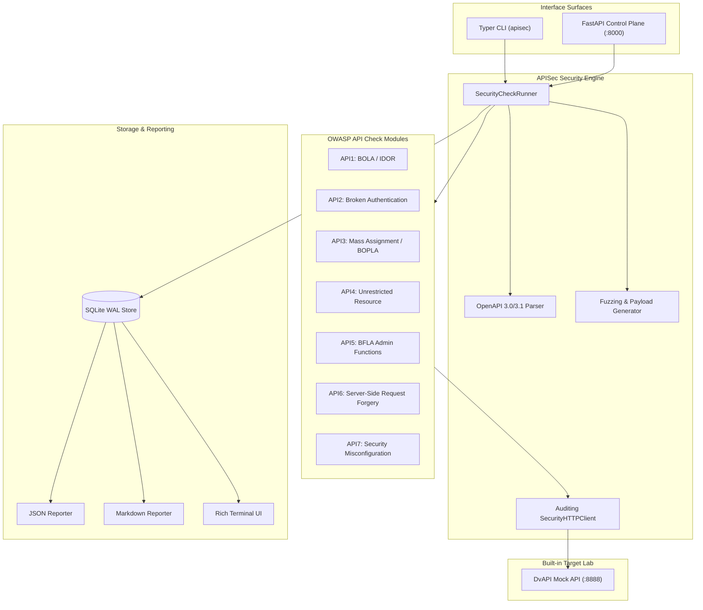

# APISec: Automated OWASP API Security Testing Lab

[](https://python.org)
[](https://github.com/astral-sh/ruff)
[](https://mypy-lang.org/)
[](https://github.com/PyCQA/bandit)
[](https://pytest.org)
[](https://opensource.org/licenses/MIT)

APISec is a production-grade, automated security testing framework and vulnerable mock laboratory (DvAPI) targeting the **OWASP API Security Top 10** vulnerabilities.

---

## Architecture Overview



---

## Features

- **OWASP API Top 10 Coverage:** Automated detection checks for BOLA, Broken Authentication, Mass Assignment, Rate Limiting, BFLA, SSRF, and CORS Misconfigurations.
- **OpenAPI 3.0 / 3.1 Parser:** Parses JSON and YAML specs from local files or remote endpoints.
- **Damn Vulnerable API (DvAPI):** Built-in mock API testbed with 8 vulnerable routes for offline testing and verification.
- **Resilient Auditing Client:** Captures full HTTP transaction traces with automatic credential redaction (`[REDACTED]`).
- **SQLite WAL Storage:** Thread-safe persistence with foreign key cascade deletion and indexing.
- **Multi-Format Reporting:** Generates machine-readable JSON, executive Markdown, and interactive Rich terminal tables.
- **Dual Interfaces:** Typer command-line interface and FastAPI REST control plane.
- **Hardened Rootless Container:** Multi-stage Docker build running under non-root UID 10001 (`apisec`).

---

## Quickstart

### 1. Installation

```bash
# Clone and set up virtual environment
python3 -m venv .venv
source .venv/bin/activate
pip install -e ".[dev]"
```

### 2. Start the DvAPI Vulnerable Lab

```bash
apisec lab start --host 127.0.0.1 --port 8888
```

DvAPI documentation will be available at:
- Swagger UI: `http://127.0.0.1:8888/docs`
- OpenAPI Spec: `http://127.0.0.1:8888/openapi.json`

### 3. Run an Automated Security Assessment

```bash
apisec scan \
  --target http://127.0.0.1:8888 \
  --auth-a mock-token-alice \
  --auth-b mock-token-bob \
  --admin mock-token-admin \
  --out report.md \
  --format markdown
```

### 4. View Scan History & Stats

```bash
# View recent scans
apisec history

# View global vulnerability statistics
apisec stats
```

---

## REST Control Plane

To run the REST API control plane:

```bash
uvicorn apisec.api.app:create_api_app --factory --host 0.0.0.0 --port 8000
```

| Method | Endpoint | Description |
|---|---|---|
| `GET` | `/health` | Service health status |
| `POST` | `/api/v1/scans` | Trigger an API security scan |
| `GET` | `/api/v1/scans` | List scan history |
| `GET` | `/api/v1/scans/{id}` | Get scan session details |
| `GET` | `/api/v1/scans/{id}/report` | Retrieve JSON or Markdown report |
| `GET` | `/api/v1/stats` | Aggregate vulnerability metrics |

---

## Docker Deployment

Run both the vulnerable mock lab and the scanner control plane using Docker Compose:

```bash
docker compose up -d
```

---

## Verification & Quality Gates

Run all quality gate checks to verify 100% adherence:

```bash
# Code formatting
ruff format --check src tests

# Static linting
ruff check src tests

# Static type checking
mypy src tests

# Security SAST audit
bandit -r src

# Unit and integration test suite with coverage
pytest --cov=src --cov-report=term-missing --cov-fail-under=90
```

---

## License

This project is licensed under the MIT License - see the [LICENSE](LICENSE) file for details.
