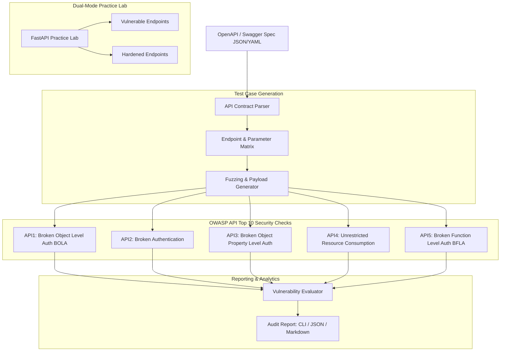

# APISec: Automated OWASP API Security Testing Lab

Enterprise-Grade Automated Audit, Fuzzing, and Vulnerability Verification Framework mapped to the OWASP API Security Top 10.

[](https://github.com/Krish9800/api-security-testing-lab/actions)
[](LICENSE)
[](https://www.python.org/)
[-orange.svg)](https://owasp.org/API-Security/)
[](https://typer.tiangolo.com/)

---

## Overview & Problem Statement

Application Programming Interfaces (APIs) represent the primary attack surface of modern cloud and mobile architectures. Traditional web vulnerability scanners designed for legacy HTML applications fail against API-specific flaws—such as Broken Object Level Authorization (BOLA), mass assignment, and rate limiting failures.

**APISec** is an automated API security testing framework and dual-mode practice laboratory. It parses OpenAPI (Swagger) specifications, generates targeted test cases across the OWASP API Security Top 10, executes fuzzing probes, records findings with CVSS v3.1 severity scores, and hosts an embedded dual-mode API lab for defensive training.

---

## Architecture & Data Flow



---

## Verified Features

- **OpenAPI Specification Parsing:** Automatically parses OpenAPI 3.0 / Swagger specifications to map endpoints, HTTP methods, parameters, and request schemas.
- **OWASP API Security Top 10 Coverage:**
  - **API1:2023 Broken Object Level Authorization (BOLA):** Substitutes ID parameters across authorization contexts.
  - **API2:2023 Broken Authentication:** Tests for missing tokens, expired tokens, and weak signing.
  - **API3:2023 Broken Object Property Level Auth:** Fuzzes hidden fields (`isAdmin`, `role`) via mass assignment.
  - **API4:2023 Unrestricted Resource Consumption:** Tests for lack of rate limiting and memory-heavy request sizes.
  - **API5:2023 Broken Function Level Authorization (BFLA):** Tests administrative endpoints using standard user credentials.
- **Embedded Dual-Mode Lab:** Interactive FastAPI service containing deliberately vulnerable routes paired with defensive code examples.
- **Audit Reports:** Generates structured findings with reproduction curl commands, CVSS scores, and remediation advice.

---

## Technology Stack

- **Runtime:** Python 3.12+
- **HTTP Engine:** HTTPX (Async)
- **Data Validation:** Pydantic v2
- **CLI Framework:** Typer & Rich
- **API Framework:** FastAPI & Uvicorn
- **Testing:** Pytest, Ruff, Mypy, Bandit

---

## Requirements & Installation

```bash
# Clone the repository
git clone https://github.com/Krish9800/api-security-testing-lab.git
cd api-security-testing-lab

# Create and activate virtual environment
python3 -m venv .venv
source .venv/bin/activate

# Install dependencies
pip install -e .
```

---

## Verified Usage Examples

### 1. Command-Line Interface (CLI)

```bash
# Scan a target API using its OpenAPI specification
apisec scan http://localhost:8000 --spec openapi.json

# Scan with authentication token and specific checks
apisec scan http://localhost:8000 --spec openapi.json --auth-token "eyJhbGciOi..." --checks bola,rate_limit

# Launch the embedded vulnerable/hardened practice lab
apisec lab --port 8080

# View past scan history and summary statistics
apisec history
apisec stats

# Generate an exportable vulnerability report from a scan session
apisec report --scan-id <session_id> --format markdown
```

### 2. REST API Service

```bash
# Start the APISec API daemon
uvicorn apisec.api.app:app --host 127.0.0.1 --port 8000
```

Endpoints available at `http://127.0.0.1:8000/docs`:
- `GET /health` — Service health check
- `GET /api/v1/scans` — List scan sessions
- `GET /api/v1/scans/{session_id}` — Inspect detailed findings for a scan session
- `GET /api/v1/scans/{session_id}/report` — Fetch formatted vulnerability report
- `GET /api/v1/stats` — Aggregated scan statistics

---

## Testing & Quality Gates

```bash
# Run complete test suite with coverage
pytest --cov=apisec --cov-report=term-missing

# Linting and static analysis
ruff check .
ruff format --check .
mypy src/apisec
```

---

## Security Model & Threat Boundaries

- **Target Scoping:** The test engine strictly confines requests to the base URL declared in the target OpenAPI specification.
- **Rate-Safe Fuzzing:** Includes delay timers and concurrency bounds to prevent accidental target denial of service.
- **Dual-Mode Lab Safety:** The practice lab is bound to localhost and runs on isolated in-memory mock data.

---

## Limitations & Known Issues

- **GraphQL Support:** Currently tailored for RESTful APIs; GraphQL introspection and query depth fuzzing are planned for future versions.
- **Complex Multi-Step Business Logic:** Automated checks test atomic endpoint vulnerabilities; intricate multi-step workflow logic (e.g. checkout fraud) requires manual test definitions.

---

## License & Responsible Use

This project is licensed under the **MIT License** — see the [LICENSE](LICENSE) file for details.

> [!CAUTION]
> **Authorization Required:** Never execute automated API security scans against production services without explicit written authorization.
