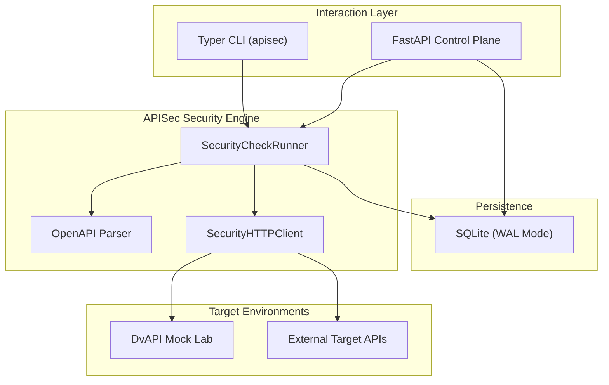

# STRIDE Threat Model - API Security Testing Lab

## 1. System Overview

APISec provides automated security testing tools and a dedicated vulnerable mock lab (DvAPI) targeting the OWASP API Security Top 10 vulnerabilities.

---

## 2. STRIDE Analysis Matrix

| Threat Category | Threat Description | Affected Component | Mitigation Strategy |
|---|---|---|---|
| **Spoofing (S)** | Unauthorized access to scan control plane or target endpoints with forged identity. | FastAPI REST Control Plane / Target APIs | Cryptographic token validation; distinct test persona tokens (`auth_token_user_a`, `auth_token_user_b`, `admin_token`) to verify isolation. |
| **Tampering (T)** | Modification of assessment reports, scan configurations, or SQLite database records. | DatabaseManager / SQLite | Strict schema constraints, foreign keys with ON DELETE CASCADE, and WAL journal mode. |
| **Repudiation (R)** | Inability to audit security testing operations and identified findings. | SecurityHTTPClient / HTTPTransaction | Comprehensive transaction logging recording timestamp, request ID, sanitized headers, payload hash, and HTTP status. |
| **Information Disclosure (I)** | Leaking sensitive Authorization tokens or credentials in test logs or reports. | HTTPTransaction Audit Trail | Automatic redaction of sensitive headers (`Authorization`, `Cookie`, `X-API-Key`, `Token`) replaced with `[REDACTED]`. |
| **Denial of Service (D)** | Scanner flooding targets causing resource starvation or scanner hanging on slow responses. | SecurityHTTPClient | Configurable timeouts, rate-limiting controls, and finite burst windows (e.g. 15 requests limit in RateLimitingCheck). |
| **Elevation of Privilege (E)** | Exploitation of scanner container to escape to host or alter scanner execution. | Docker / Execution Environment | Rootless container execution using non-root UID 10001 (`apisec`) without host volume privilege escalation. |

---

## 3. Trust Boundaries

1. **Host to Container Boundary:** Isolated through Docker rootless UID 10001.
2. **Scanner to Target Boundary:** External HTTP requests treated as untrusted network traffic; timeouts and exceptions caught cleanly.
3. **Database Boundary:** Parameterized queries neutralize SQL injection.
